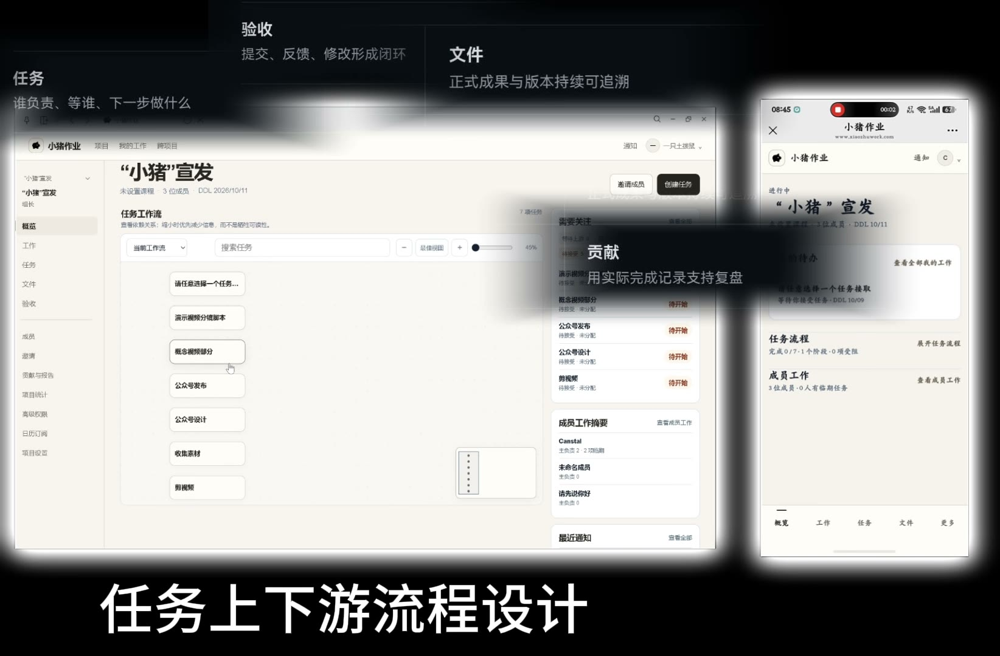
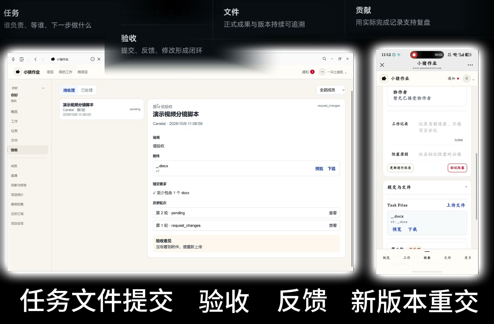
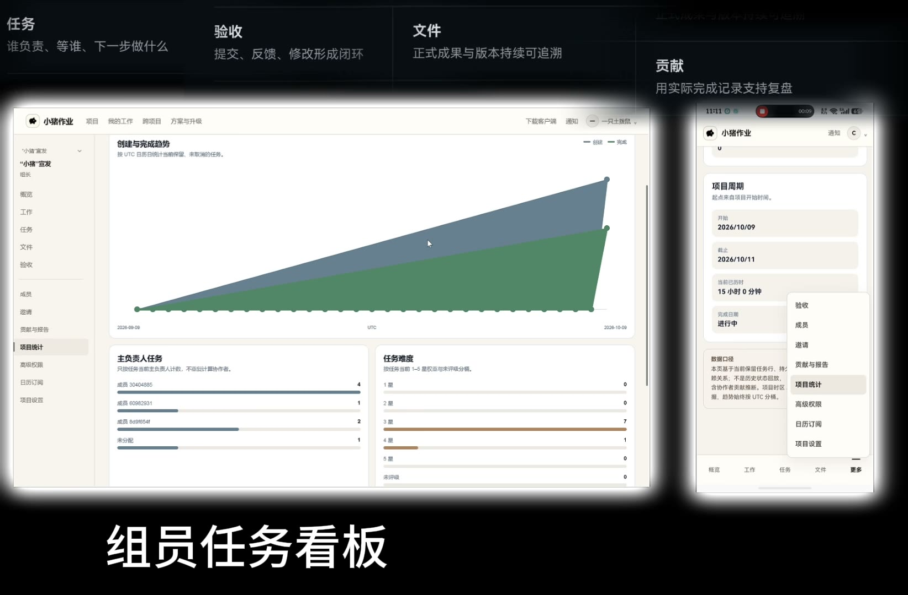

# 小猪作业 · XiaozhuWork

面向大学生课程小组与轻量项目团队的协作平台，将任务分工、依赖关系、成果提交、验收与贡献记录串成完整流程。

**我在 AI 辅助下基本独立完成产品开发，推进外测，并根据用户反馈持续完善功能。**

## 源码与本地运行

[查看完整应用源码与运行说明](app/README.md)

`app/` 包含 Web 前端、Ops 管理界面、Supabase 数据库迁移与 Edge Functions、Android 工程、测试及构建脚本。

```bash
git clone https://github.com/Summernight0708/xiaozhuwork-showcase.git
cd xiaozhuwork-showcase/app
corepack pnpm install --frozen-lockfile
```

按[运行说明](app/README.md)配置自己的 Supabase 环境后，执行 `corepack pnpm dev` 启动产品。

## 从实际协作问题出发

小组协作中，任务分配杂乱、贡献不清，成员需要反复询问进度和确认成果。小猪作业围绕这些问题，将负责人、任务要求、提交材料与验收结果集中到同一个项目中。

## 产品演示

[观看约 20 秒的产品操作演示](demo/product-demo.mp4)

演示流程：**明确分工 → 查看依赖 → 提交成果 → 验收与重交 → 查看文件及贡献记录**。

### 任务分工与上下游依赖



### 成果提交、验收与重交



### 项目数据看板



## 核心功能

| 协作环节 | 产品功能 |
| --- | --- |
| 组建项目 | 项目创建、成员邀请、角色与权限管理 |
| 分配工作 | 任务负责人、协作者、截止时间和依赖关系 |
| 提交成果 | 文字与附件提交、文件版本及历史记录 |
| 确认交付 | 验收、打回与重新提交 |
| 记录贡献 | 贡献分配、贡献记录与项目报告 |

## 根据外测反馈迭代

产品已完成外测，测试期间根据用户建议持续完善功能与交互。以下选取三个迭代案例：

| 用户反馈 | 完成的改进 | 使用体验 |
| --- | --- | --- |
| 邮箱登录操作麻烦，希望使用账号密码 | 完善账号密码登录方式 | 提供更便捷的登录选择 |
| 创建任务时需要附上填表原件或模板 | 增加任务创建时的附件上传 | 将模板与任务要求一起交付给执行者 |
| 任务截止时间超出项目期限时，报错含义不清晰 | 完善时间冲突提示 | 明确指出任务时间与项目期限的关系，帮助用户调整 |

## 我的工作

- 根据自身小组协作经历明确任务分配与贡献记录的产品目标。
- 在 AI 辅助下基本独立完成产品开发，组织任务、依赖、提交与验收等协作流程。
- 持续收集外测建议，判断改进方向，推进功能完善与交互优化。

## 技术实现

| 部分 | 技术 |
| --- | --- |
| Web | Vue 3、Vite、TypeScript、Pinia |
| 后端 | Supabase、PostgreSQL、Auth、Storage、Edge Functions |
| 验证工具 | Vitest、Playwright、pgTAP |
| Android | Capacitor |

项目开发时间：2026 年 9—10 月。
